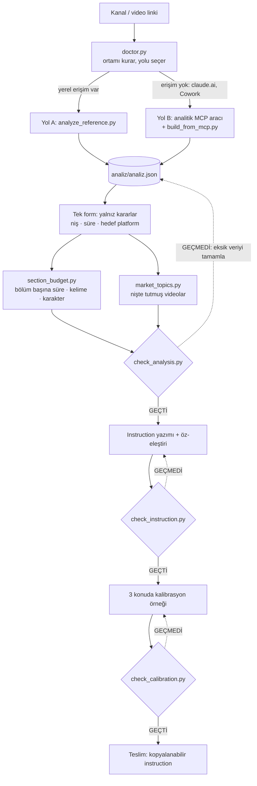

# Mimari

promptexe bir Agent Skill'dir: `SKILL.md` akışı ve kararları anlatır, ölçülebilir her şeyi
`scripts/` altındaki Python script'leri yapar, yorum ve yazım rehberi `references/` altındadır.
Model sayı tahmin etmez; her ölçümü bir script verir, her aşamayı bir kapı script'i denetler.

## Akış



## Veri yolları

| Yol | Ne zaman | Kaynak |
|---|---|---|
| **A — yerel** | `doctor.py` "tam" derse (Claude Code, kendi makinen) | yt-dlp + ffmpeg + faster-whisper; ücretsiz, en zengin (ısı haritası, kendi kare analizi) |
| **B — MCP** | Yerel indirme yoksa (claude.ai, Cowork, kısıtlı ağ) | Oturumdaki YouTube analitik MCP aracı (ör. Nexlev); çağrı sırası `references/mcp-yolu.md` |

İki yol da aynı şemada `analiz.json` üretir; 4. adımdan sonrası ortaktır.

## Yol A içinde: `analyze_reference.py`

Tek komut, paralel çalışır (izleme transkriptleri beklemez):

1. **Kanal haritası** — `fetch_channel.py`: sekme bazında liste, eksik izlenme/süre paralel
   tamamlanır, medyana göre outlier skoru. Sıralama format ve yaş düzeltmelidir: süresi medyanın
   0,5–2 katı dışındakiler format dışı; olgun kanalda toplam izlenme, genç kanalda günlük izlenme.
2. **Video seçimi** — verilen video + en iyi 3 + en zayıf 1. Zayıf aday, kanalın ana formatı
   olmayan numaralı bir seriden (ör. "… 9. Gün Özeti") gelemez ve ses dili popülerlerle aynı olmalıdır.
3. **Transkript** — `fetch_transcript.py`: elle altyazı (bölgesel varyant dahil) → otomatik
   altyazı → Whisper (VAD ile; konuşmasız video `konusma_yok` işaretlenir). Ölçüler yalnız ses
   dilindeki metinden.
4. **Tempo** — `transcript_stats.py`: kelime/dk, cümle uzunluğu, giriş metni, hitap yoğunluğu.
5. **İzleme** — `watch_video.py`: girişin kareleri, temas sayfası, sert kesim sayısı ve
   dHash ile görsel değişim. Kesim, görsel değişimin yarısından azsa kurgu "yumuşak geçiş"
   sayılır ve sahne bütçesi görsel değişimden alınır.
6. **Metadata** — bölümler, ısı haritası tepeleri, en iyi yorumlar; kanal listesi başlıkları
   video başlıklarından farklıysa "çevrilmiş başlık" uyarısı.

## Kapılar

| Kapı | Denetler |
|---|---|
| `check_analysis.py` | Zorunlu alanlar, transkript sayısı, izleme gözlemi, ≥6 bulgu (veri/varsayım + kanıt), uyarlama |
| `check_instruction.py` | Rakip adı sızıntısı, referans transkriptlerle ortak kelime dizisi (kopya), zorunlu kurallar, bütçe tablosu (kelime + karakter), piyasadan konu havuzu, sahne promptu varsa zamanlı numune; hedef platform uzunluk sınırı uyarı olarak |
| `check_calibration.py` | Örnek açılışların bütçeye uyumu (kelime + karakter) ve birbirine benzerliği |

## Klasörler

```
SKILL.md                 akış, ilkeler, derin düşünme noktaları
scripts/
  _env.py                yt-dlp / ffmpeg bulucu, skill'e özel sanal ortam
  doctor.py              ortam kontrolü ve kurulum
  analyze_reference.py   Yol A, tek komut
  build_from_mcp.py      Yol B → analiz.json
  fetch_channel.py  fetch_transcript.py  transcript_stats.py  watch_video.py
  section_budget.py  market_topics.py
  check_analysis.py  check_instruction.py  check_calibration.py
references/              analiz rehberi, dağıtım mantığı, kanal tipleri, instruction yazımı,
                         veri toplama, MCP yolu
assets/ornek-instruction.md   kalite ölçüsü (şablon değil)
```

## Çalışma klasörü ve gizlilik

İndirilen video/ses ve sanal ortam `~/.cache/promptexe` altına yazılır (`PROMPTEXE_HOME` ile
değiştirilebilir). Skill hiçbir anahtar, token ya da hesap bilgisi istemez veya saklamaz; ücretli
bir analitik aracının kredi harcayan adımı gerekirse önce kullanıcıdan onay ister.
